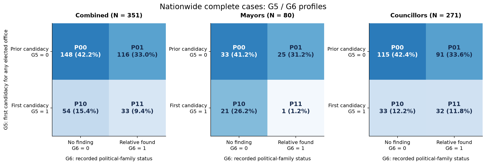
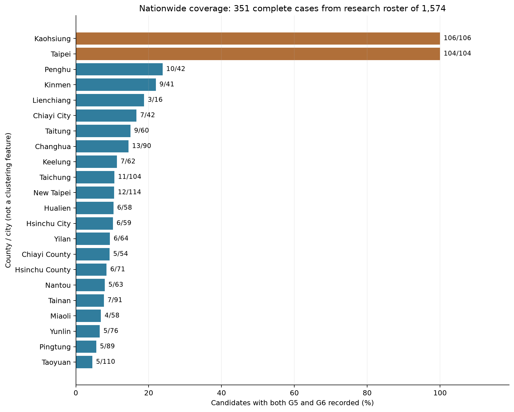

# 全臺G5／G6補查與完整值分群（2026-11-08）

作者：RUEI-HSIANG, CHANG／張睿庠（B12303030；AI協助）。已執行並保存輸出；本地待提交。

本次已沿用兩市方法完成**全臺範圍的完整值分群**：合併351人、首長80人、議員271人，三池皆含22縣市。**不是所有1583筆登記者都已補齊**。資格後研究母表1574人，仍有1223人因G5或G6缺值未進群；議員分析有199／271人（73.43%）來自臺北與高雄，不能當作全國候選人背景的代表性普查。

[正式已執行finding](../finding/national_g5_g6_clustering_20261108.ipynb) · [資料準備](../data/code/prepare_national_g5_g6_20261108.ipynb) · [資料及全部輸出文件](../data/processed/national_g5_g6_20261108_documentation.ipynb) · [搜尋／判讀原始文件](../data/raw/taiwan_completion_20261108_documentation.ipynb)

## 本輪補查與編碼

- 以全國1583人版為基礎，按candidate_key合併已完成兩市210人新版。兩市51欄逐格保留，包含游智彬官方資格與研究暫納入的分離紀錄。
- 合併兩市後G5缺636、G6缺1296。本輪**G5補287筆、G6補66筆**，不是把整批未查G6改0。
- G5：逐檔核SHA後掃描145份可用CEC歷史CSV；manifest有146個archive member記錄，但2008總統兩項指同一保存檔。284人無正規化姓名／中文別名命中，依楊喬茵修訂規則暫編1並標推論旗標；3人核對生日、學校及跨區參選經歷後編0：鄧凱勛（曾選臺中何福里長）、周曉芸（曾選金門議員，現桃園）、童小芸（曾選臺南立委／議員）。其餘349個同名命中保留未知，沒有只靠名字強行合併。
- G6：49位尚缺首長與14位區域議員各兩輪指定搜尋，核心查詢共126項；另有針對性追查與主文擷取。已讀全文額外確認4位親屬，共67份逐人判讀：10個正碼、56個搜尋未發現負碼、曹爾元1個未決。一般軍文職、單純黨職／後援會職務、僅候選人而未任公職不計入G6=1。
- 全1583筆補查後仍缺G5=349、G6=1230；資格後1574筆分別缺346、1221，兩欄可重疊，故缺值排除1223而非兩者相加。G1、G3等缺值不影響本輪G5/G6納入；351人中仍保留37位年齡缺值者。

逐人稽核：[G5 636人](../data/processed/national_g5_g6_g5_audit_20261108.csv)、[G6 67人](../data/processed/national_g5_g6_g6_audit_20261108.csv)、[續查佇列1223人](../data/processed/national_g5_g6_gap_queue_20261108.csv)。搜尋未發現是操作性編碼，不能寫成已證明「沒有政治人物親戚」。

例如，完整文章確認鍾東錦的親外甥林禹佑已任新竹縣議員，為三親等，兩人G6都補1；[來源全文](https://www.mirrormedia.mg/external/setn_1931700)。徐筱菁的祖父曾任村長、伯父曾任鄉民代表，分別二、三親等，符合；[聯合報全文](https://video.udn.com/news/1169666)。胡仁順報導中的堂舅莊枝財為五親等，超出既定範圍，本輪搜尋未找到其他符合親屬才編0；[來源全文](https://tw.news.yahoo.com/罷傅-被挖有前科-胡仁順自曝-黑歷史-不要想以此威脅我-024015319.html)。曹爾元雖有曹氏宗親、胞弟黨職／曾參選線索，仍未核實符合親等與任用性質，因此保留未知並從本次首長分群剔除。

## 研究母表與資格處理

| 池 | 資格後研究母表N | G5/G6完整納入N | 缺值排除N | 保留率 |
| --- | ---: | ---: | ---: | ---: |
| 全部合併 | 1574 | 351 | 1223 | 22.30% |
| 全國首長 | 81 | 80 | 1 | 98.77% |
| 全國議員 | 1493 | 271 | 1222 | 18.15% |

合併池是首長與議員聯集，三池不能相加。研究範圍沒有拆成各縣市另跑模型。

資格沿用[2026-10-16中選會公告](https://web.cec.gov.tw/central/article/65212)與已存全文，1583筆中其他9位資格不符議員剔除：林正峰、蕭湘瀚、鄭伯其、曹暐國、鍾任明、何博倫、周駿宥、石永城、張芳麗。游智彬依學生先前明確決定研究暫納入，維持資格爭議旗標1；官方不符／暫時救濟紀錄未改寫成合格，也未假稱本輪重新完成司法審查。

[1583筆含資格旗標完整roster](../data/processed/national_g5_g6_roster_20261108.csv)保留全部排除依據；[1574筆研究母表](../data/processed/national_g5_g6_all_20261108.csv)仍含缺值，分群指派僅含351完整觀察。

## 原方法與結果

只用G5、G6兩個二元類別，等權對稱Gower等於Hamming距離：不同欄數除以2，距離為0、0.5或1。沿用average linkage，先固定candidate_key排序，主結果在距離0切群，固定P碼按G5／G6順序。這是兩二元特徵的觀察組合，沒有高低優劣順序；不加入縣市、年齡、學歷或資格旗標。

| 組合   | 意義                         | 合併N=351     | 首長N=80     | 議員N=271     |
|:-------|:-----------------------------|:--------------|:-------------|:--------------|
| P00    | 曾參選／搜尋未發現公職親屬   | 148（42.17%） | 33（41.25%） | 115（42.44%） |
| P01    | 曾參選／有公職親屬           | 116（33.05%） | 25（31.25%） | 91（33.58%）  |
| P10    | 首次參選／搜尋未發現公職親屬 | 54（15.38%）  | 21（26.25%） | 33（12.18%）  |
| P11    | 首次參選／有公職親屬         | 33（9.40%）   | 1（1.25%）   | 32（11.81%）  |

P00可讀為「曾參選、搜尋未發現符合公職親屬」，P01為「曾參選、有公職親屬」，P10為「首次參選、搜尋未發現」，P11為「首次參選、有公職親屬」。G5=1包含已標記的檔案非命中推論；全名冊284人中只有8人同時有G6進入本次分析。

合併／議員主群silhouette=1是重複組合的機械結果，不能稱為完美分類。首長P11只有吳淑瑾1人，按套件定義單人silhouette=0，故首長平均為0.9875，未通過每群至少8人的人數診斷；此群只作描述，不為達人數門檻擅自改資料。

### 兩群與三群替代解

| 池      |   K | 各群人數      | 各群組合        |   平均silhouette |   最小群N |
|:--------|----:|:--------------|:----------------|-----------------:|----------:|
| all     |   2 | 264|87        | P00+P01|P10+P11 |           0.6716 |        87 |
| all     |   3 | 148|116|87    | P00|P01|P10+P11 |           0.8819 |        87 |
| all     |   4 | 148|116|54|33 | P00|P01|P10|P11 |           1      |        33 |
| mayor   |   2 | 54|26         | P00+P10|P01+P11 |           0.7425 |        26 |
| mayor   |   3 | 33|26|21      | P00|P01+P11|P10 |           0.975  |        21 |
| mayor   |   4 | 33|25|21|1    | P00|P01|P10|P11 |           0.9875 |         1 |
| council |   2 | 206|65        | P00+P01|P10+P11 |           0.6675 |        65 |
| council |   3 | 115|91|65     | P00|P01|P10+P11 |           0.8782 |        65 |
| council |   4 | 115|91|33|32  | P00|P01|P10|P11 |           1      |        32 |

固定鍵排序時，合併與議員K=2主要合併成曾參選／首次參選；K=3再把曾參選拆成有／搜尋未發現親屬。首長K=2則先按G6合併，K=3保留P00與P10、合併P01+P11。這些不是唯一分類：距離0.5有並列，列序可影響合併。

| 池      |   K |   100次重排相同分割比例 |   最小ARI |
|:--------|----:|------------------------:|----------:|
| all     |   2 |                    0.58 |   -0.007  |
| all     |   3 |                    0.57 |    0.4177 |
| all     |   4 |                    1    |    1      |
| mayor   |   2 |                    0.47 |   -0.0116 |
| mayor   |   3 |                    0.47 |    0.9674 |
| mayor   |   4 |                    1    |    1      |
| council |   2 |                    0.7  |    0.0022 |
| council |   3 |                    0.64 |    0.408  |
| council |   4 |                    1    |    1      |

100次隨機列序重排、seed=20261108，四組合主群ARI均1，K2／K3並非如此。500次候選人有放回bootstrap也同原方法；首長單人P11有179／500次完全未抽到（35.8%）。完整原集合平均Jaccard約0.63受重抽涵蓋率影響，共同支撐集合有抽到時Jaccard=1仍是二元組合結構的必然性，不能當外部驗證。

### 證據與暫納入敏感度

移除本輪僅以歷史檔無命中推論G5的8位，合併N=343、議員N=263，最大組合比例差分別2.1131、2.6826百分點。移除游智彬後合併N=350、議員N=270，最大差0.1652、0.2132百分點；首長無變動。所有情境共同候選人的主P碼相同，這是固定G5/G6組合的結構性結果，不能推出對真實選舉結果沒有影響。

[敏感度摘要](../data/processed/national_g5_g6_evidence_sensitivity_20261108.csv) · [逐組合比例差](../data/processed/national_g5_g6_profile_sensitivity_20261108.csv) · [列序診斷](../data/processed/national_g5_g6_order_sensitivity_20261108.csv) · [bootstrap](../data/processed/national_g5_g6_bootstrap_20261108.csv)

## 22縣市覆蓋與限制

| 縣市   |   資格後研究母表N |   進入分群N |   G5或G6缺值排除N |   保留率% |
|:-------|------------------:|------------:|------------------:|----------:|
| 南投縣 |                63 |           5 |                58 |      7.94 |
| 嘉義市 |                42 |           7 |                35 |     16.67 |
| 嘉義縣 |                54 |           5 |                49 |      9.26 |
| 基隆市 |                62 |           7 |                55 |     11.29 |
| 宜蘭縣 |                64 |           6 |                58 |      9.38 |
| 屏東縣 |                89 |           5 |                84 |      5.62 |
| 彰化縣 |                90 |          13 |                77 |     14.44 |
| 新北市 |               114 |          12 |               102 |     10.53 |
| 新竹市 |                59 |           6 |                53 |     10.17 |
| 新竹縣 |                71 |           6 |                65 |      8.45 |
| 桃園市 |               110 |           5 |               105 |      4.55 |
| 澎湖縣 |                42 |          10 |                32 |     23.81 |
| 臺中市 |               104 |          11 |                93 |     10.58 |
| 臺北市 |               104 |         104 |                 0 |    100    |
| 臺南市 |                91 |           7 |                84 |      7.69 |
| 臺東縣 |                60 |           9 |                51 |     15    |
| 花蓮縣 |                58 |           6 |                52 |     10.34 |
| 苗栗縣 |                58 |           4 |                54 |      6.9  |
| 連江縣 |                16 |           3 |                13 |     18.75 |
| 金門縣 |                41 |           9 |                32 |     21.95 |
| 雲林縣 |                76 |           5 |                71 |      6.58 |
| 高雄市 |               106 |         106 |                 0 |    100    |

兩市原210人全部保留，其他20縣市只有141／1364（10.34%）；其中其他20縣市議員只有72／1294（5.56%）。有些縣市議員僅1–3人，這個資料可用性選樣很嚴重；政治家族正碼也往往更易被媒體報導。不能把群比例當全國盛行率、不能用來宣稱某縣市更常出現政治家族，也沒有選票或競選策略結果的因果分析。

[66列三池×縣市覆蓋表](../data/processed/national_g5_g6_coverage_20261108.csv)、[兩市／其他20縣市構成](../data/processed/national_g5_g6_composition_20261108.csv)均附分母。下一輪續查直接用gap queue，優先兩市以外議員；同名但無生日、學校或經歷錨的個案留待核實。

## 保存、驗證與版本

4份Notebook已由clean kernel依序執行並保留輸出：資料準備、正式finding、raw文件、processed文件。20份CSV皆在實際producer序列化後重新開啟核對，4份JSON另回讀；來源SHA、schema、鍵、三池分割、原兩市210人逐格保留、22縣市、缺值與群碼均通過檢查。三張圖已檢視。

逐人結果：[合併351](../data/processed/national_g5_g6_all_assignments_20261108.csv)、[首長80](../data/processed/national_g5_g6_mayor_assignments_20261108.csv)、[議員271](../data/processed/national_g5_g6_council_assignments_20261108.csv)。[驗證JSON](../data/processed/national_g5_g6_validation_20261108.json)、[輸出manifest](../data/processed/national_g5_g6_output_manifest_20261108.json)含精確輸入SHA、方法、版本與亂數種子。

原[兩市210人版](taipei_kaohsiung_g5_g6_yu_provisional_20261108.md)、209人對照版與舊全國G1–G6檔保留。本輪另存全國結果，沒有覆寫舊分群，也沒有stage、commit或push。上傳狀態仍待學生自行提交。
