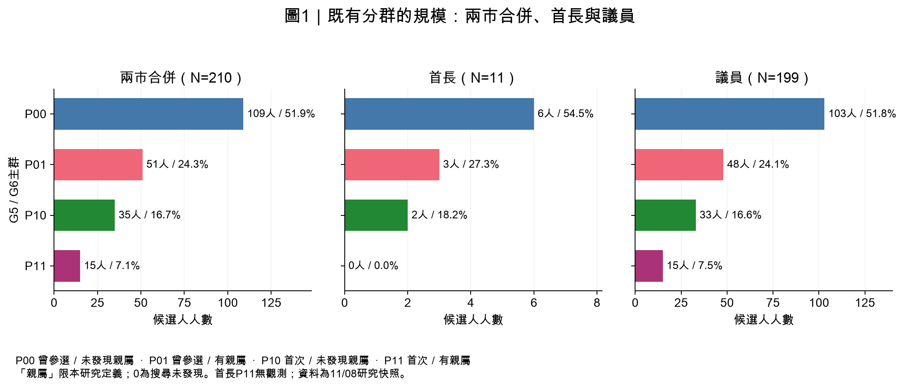
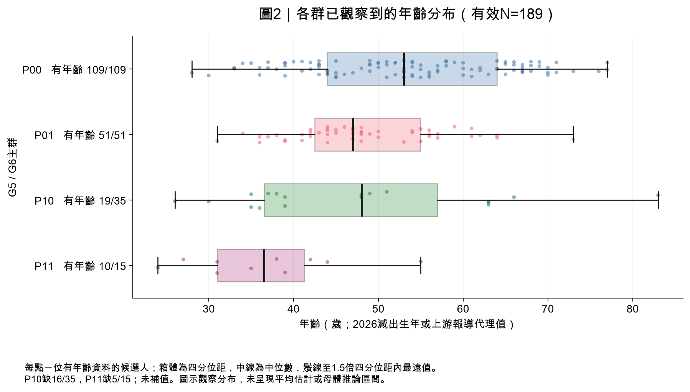
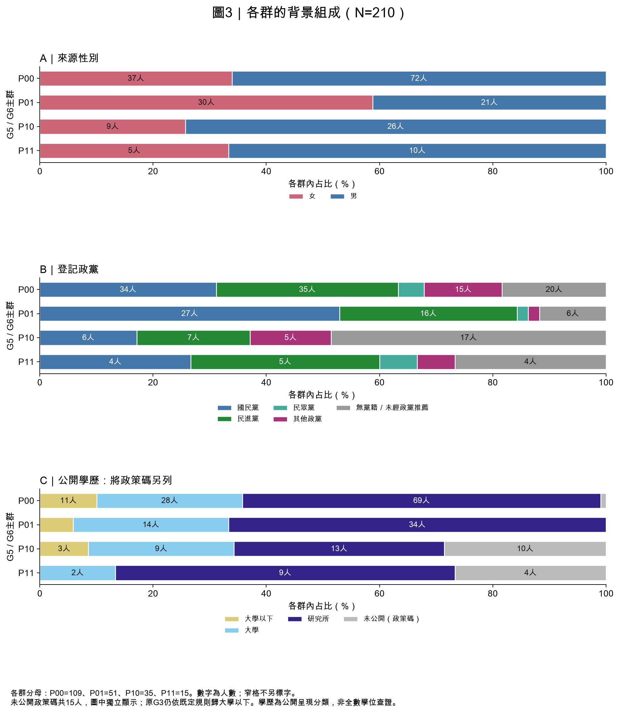

# 臺北市與高雄市候選人分群結果及背景特徵

作者：RUEI-HSIANG, CHANG（張睿庠，B12303030；AI協助）  
整理日期：2026-11-10；分析資料與既有分群：2026-11-08研究快照。

## 重點摘要

本報告分析兩市210位候選人，包含首長11人、議員199人。只用G5「是否首次參選任何民選公職」與G6「是否有符合範圍的公職親屬」形成的四個主群，分別為109、51、35及15人。年齡、性別、公開學歷、政黨、城市及公職用來描述各群，沒有加入分群距離。

**主要觀察：** 曾參選且有公職親屬的P01群女性比例最高（58.8%）；首次參選且搜尋未發現符合親屬的P10群無黨籍比例最高（48.6%）；首次參選且有公職親屬的P11群在有年齡資料者中最年輕（平均36.6歲），但只有10/15人有年齡，須連同缺值閱讀。

## 一、樣本與方法

沿用兩市合併／首長／議員三池，210=11+199；城市只作群內分布比較，沒有新增臺北與高雄各自分群。游智彬依11/08研究決定暫納入P00，保留官方資格爭議註記，不表示本輪重新查核或認定11/10官方合格。

G5=0表示曾參選任何民選公職，包含曾落選，不能直接稱現任或資深政治人物；G5=1按楊修訂規則編為首次，部分依歷史資料未命中推論。G6=1限配偶或三親等內血／姻親曾任民選或政治任命公職，一般軍職與常任文官不計。G6=0表示完成記錄搜尋後未發現符合範圍證據，不代表沒有任何政治人物親戚。

原分群採等權重對稱Gower類別距離（此處等同Hamming）、平均連結法與距離0切樹。兩個二元變數最多四個組合，所以主群是容易解釋的背景分類。其他特徵缺值不會讓候選人退出原分群；G5/G6缺值排除0人。

## 二、分成哪些群？

**表1：主群人數與池內占比；合併N=210、首長N=11、議員N=199。**

| 主群   | 背景組合                 | 兩市合併 N=210   | 首長 N=11     | 議員 N=199       |
|:-------|:-------------------------|:-----------------|:--------------|:-----------------|
| P00    | 曾參選／未發現符合親屬   | 109/210（51.9%） | 6/11（54.5%） | 103/199（51.8%） |
| P01    | 曾參選／有符合公職親屬   | 51/210（24.3%）  | 3/11（27.3%） | 48/199（24.1%）  |
| P10    | 首次參選／未發現符合親屬 | 35/210（16.7%）  | 2/11（18.2%） | 33/199（16.6%）  |
| P11    | 首次參選／有符合公職親屬 | 15/210（7.1%）   | 0/11（0.0%）  | 15/199（7.5%）   |

圖1呈現原主群在三池的規模；首長P11為0人，因此首長只有三個非空主群。議員占合併樣本94.8%，合併分布主要反映議員。

### 四群可以如何描述

- **P00：曾參選、搜尋未發現符合公職親屬。** 109人、占51.9%，是最大群；觀察平均53.4歲，年齡109人都有資料。女性33.9%；國民黨34人、民進黨35人，兩黨人數接近。這個群名不表示已證明沒有政治家族。
- **P01：曾參選、有符合範圍的公職親屬。** 51人、占24.3%；平均48.5歲，年齡完整；女性30人（58.8%），四群最高。國民黨27人（52.9%）；研究所類34人（66.7%）。
- **P10：首次參選、搜尋未發現符合公職親屬。** 35人、占16.7%；無黨籍17人（48.6%）。只有19人有年齡，平均47.2歲，另16人缺值。學歷未公開政策碼10人，不能依原最低類數字稱此群低學歷。
- **P11：首次參選、有符合範圍的公職親屬。** 15人、占7.1%，全為議員候選人；有年齡者10人平均36.6歲。女性5人（33.3%）；公開研究所類9人，另4人是學歷政策碼。可以描述為「觀察年齡較低的首次參選公職親屬群」，不能由此推論家族導致提早參選。

## 三、其他特徵比較

**表2：四群背景摘要（N=210）；女性、研究所與政策碼比例的分母為各群全部人數，年齡有效N另列。**

| 主群   |   人數 | 平均年齡（有效N）   | 女性            | 公開研究所類    | 學歷政策碼     |
|:-------|-------:|:--------------------|:----------------|:----------------|:---------------|
| P00    |    109 | 53.4（109/109）     | 37/109（33.9%） | 69/109（63.3%） | 1/109（0.9%）  |
| P01    |     51 | 48.5（51/51）       | 30/51（58.8%）  | 34/51（66.7%）  | 0/51（0.0%）   |
| P10    |     35 | 47.2（19/35）       | 9/35（25.7%）   | 13/35（37.1%）  | 10/35（28.6%） |
| P11    |     15 | 36.6（10/15）       | 5/15（33.3%）   | 9/15（60.0%）   | 4/15（26.7%）  |

### 年齡及缺值

**表3：各群年齡描述（單位歲；總N=210、年齡有效N=189）。**

| 主群   |   群人數 |   年齡有效N |   年齡缺值N |   平均歲數 |   標準差 |   中位數 |   最小 |   第25百分位 |   第75百分位 |   最大 |
|:-------|---------:|------------:|------------:|-----------:|---------:|---------:|-------:|-------------:|-------------:|-------:|
| P00    |      109 |         109 |           0 |      53.37 |    11.75 |     53   |     28 |         44   |        64    |     77 |
| P01    |       51 |          51 |           0 |      48.45 |     8.76 |     47   |     31 |         42.5 |        55    |     73 |
| P10    |       35 |          19 |          16 |      47.21 |    14.71 |     48   |     26 |         36.5 |        57    |     83 |
| P11    |       15 |          10 |           5 |      36.6  |     9.11 |     36.5 |     24 |         31   |        41.25 |     55 |

全部21個年齡缺值都在首次參選者：P10缺16/35（45.7%），P11缺5/15（33.3%）。圖2及平均值只描述有資料者，不能視為全群真實平均或假設缺值隨機。年齡包含2026減出生年與上游保留的報導年齡代理值，未一律核實精確足歲；鄧巧佩的出生年／報導年齡衝突旗標保留。圖示箱體、中位數及個體分布，沒有估計母體效果。

### 性別與政黨

**表4：來源性別（N=210；分母為各群全體）。**

| 主群   |   群人數 | 女              | 男              |
|:-------|---------:|:----------------|:----------------|
| P00    |      109 | 37/109（33.9%） | 72/109（66.1%） |
| P01    |       51 | 30/51（58.8%）  | 21/51（41.2%）  |
| P10    |       35 | 9/35（25.7%）   | 26/35（74.3%）  |
| P11    |       15 | 5/15（33.3%）   | 10/15（66.7%）  |

**表5：登記政黨（N=210；分母為各群全體）。**

| 主群   |   群人數 | 國民黨          | 民進黨          | 民眾黨        | 其他政黨        | 無黨籍／未經政黨推薦   |
|:-------|---------:|:----------------|:----------------|:--------------|:----------------|:-----------------------|
| P00    |      109 | 34/109（31.2%） | 35/109（32.1%） | 5/109（4.6%） | 15/109（13.8%） | 20/109（18.3%）        |
| P01    |       51 | 27/51（52.9%）  | 16/51（31.4%）  | 1/51（2.0%）  | 1/51（2.0%）    | 6/51（11.8%）          |
| P10    |       35 | 6/35（17.1%）   | 7/35（20.0%）   | 0/35（0.0%）  | 5/35（14.3%）   | 17/35（48.6%）         |
| P11    |       15 | 4/15（26.7%）   | 5/15（33.3%）   | 1/15（6.7%）  | 1/15（6.7%）    | 4/15（26.7%）          |

P01女性占比最高，P10無黨籍占比最高。這些是各群內的分布；例如52.9%指P01中有52.9%登記國民黨，並不是52.9%的國民黨候選人屬P01。

### 公開學歷與政策碼

**表6：原公開呈現學歷編碼（N=210；沿用既定規則）。**

| 主群   |   群人數 | 大學以下        | 大學            | 研究所          |
|:-------|---------:|:----------------|:----------------|:----------------|
| P00    |      109 | 12/109（11.0%） | 28/109（25.7%） | 69/109（63.3%） |
| P01    |       51 | 3/51（5.9%）    | 14/51（27.5%）  | 34/51（66.7%）  |
| P10    |       35 | 13/35（37.1%）  | 9/35（25.7%）   | 13/35（37.1%）  |
| P11    |       15 | 4/15（26.7%）   | 2/15（13.3%）   | 9/15（60.0%）   |

原G3有15筆「搜尋後未公開可採資訊→大學以下」政策碼：P00 1人、P01 0人、P10 10人、P11 4人。P10原13筆大學以下有10筆是政策碼；P11原4筆大學以下全部是政策碼。因此「未公開」不能解讀成真實低學歷。

**表7：排除政策碼後的教育描述（有效N=195；只調整本表分母，不刪分群樣本或改寫G3）。**

| 主群   |   原群N |   政策碼人數 |   非政策碼N | 大學以下（非政策碼）   | 大學（非政策碼）   | 研究所（非政策碼）   |
|:-------|--------:|-------------:|------------:|:-----------------------|:-------------------|:---------------------|
| P00    |     109 |            1 |         108 | 11/108（10.2%）        | 28/108（25.9%）    | 69/108（63.9%）      |
| P01    |      51 |            0 |          51 | 3/51（5.9%）           | 14/51（27.5%）     | 34/51（66.7%）       |
| P10    |      35 |           10 |          25 | 3/25（12.0%）          | 9/25（36.0%）      | 13/25（52.0%）       |
| P11    |      15 |            4 |          11 | 0/11（0.0%）           | 2/11（18.2%）      | 9/11（81.8%）        |

排除政策碼後，P10研究所類為13/25（52.0%），P11為9/11（81.8%）。這仍只是公開資訊分類，不等同全部學位完成與真偽已查證。

圖3用各群全體作分母；教育部分將15筆政策碼另列，便於看出資料可見度差異。條內數字為人數，窄格省略標字。

## 四、臺北與高雄、公職類型有何不同？

**表8：各市內的群別占比（臺北104人、高雄106人）。**

| 城市   |   候選人N | P00             | P01             | P10             | P11           |
|:-------|----------:|:----------------|:----------------|:----------------|:--------------|
| 臺北市 |       104 | 55/104（52.9%） | 21/104（20.2%） | 21/104（20.2%） | 7/104（6.7%） |
| 高雄市 |       106 | 54/106（50.9%） | 30/106（28.3%） | 14/106（13.2%） | 8/106（7.5%） |

臺北首次參選且未發現符合親屬的P10占20.2%，高雄13.2%；高雄曾參選且有符合親屬的P01占28.3%，臺北20.2%。此處為原合併群別的城市分布，不是兩套新的分群。

**表9：議員池各群背景（N=199；年齡有效178人）。**

| 主群   |   人數 | 平均年齡（有效N）   | 女性            | 公開研究所類    | 學歷政策碼     |
|:-------|-------:|:--------------------|:----------------|:----------------|:---------------|
| P00    |    103 | 52.8（103/103）     | 37/103（35.9%） | 65/103（63.1%） | 1/103（1.0%）  |
| P01    |     48 | 48.2（48/48）       | 29/48（60.4%）  | 31/48（64.6%）  | 0/48（0.0%）   |
| P10    |     33 | 45.4（17/33）       | 9/33（27.3%）   | 13/33（39.4%）  | 10/33（30.3%） |
| P11    |     15 | 36.6（10/15）       | 5/15（33.3%）   | 9/15（60.0%）   | 4/15（26.7%）  |

議員P01女性比例為29/48（60.4%）；議員P11已觀察年齡平均36.6歲。年齡仍缺21人。

**表10：首長11人逐人特徵（固定11/08研究名冊）。**

| 姓名   | 城市   | 主群   |   年齡（歲） | 來源性別   | 公開學歷分類   | 登記政黨             |
|:-------|:-------|:-------|-------------:|:-----------|:---------------|:---------------------|
| 郭璽   | 臺北市 | P00    |           68 | 男         | 大學           | 其他政黨             |
| 蕭文乾 | 臺北市 | P00    |           52 | 男         | 研究所         | 其他政黨             |
| 唐新民 | 臺北市 | P00    |           76 | 男         | 研究所         | 其他政黨             |
| 林志成 | 臺北市 | P00    |           61 | 男         | 研究所         | 無黨籍／未經政黨推薦 |
| 張靜   | 高雄市 | P00    |           70 | 男         | 大學           | 其他政黨             |
| 賴瑞隆 | 高雄市 | P00    |           53 | 男         | 研究所         | 民進黨               |
| 沈伯洋 | 臺北市 | P01    |           44 | 男         | 研究所         | 民進黨               |
| 蔣萬安 | 臺北市 | P01    |           48 | 男         | 研究所         | 國民黨               |
| 柯志恩 | 高雄市 | P01    |           64 | 女         | 研究所         | 國民黨               |
| 王肇民 | 高雄市 | P10    |           63 | 男         | 大學           | 無黨籍／未經政黨推薦 |
| 洪方隆 | 高雄市 | P10    |           63 | 男         | 大學           | 無黨籍／未經政黨推薦 |

首長P00／P01／P10只有6／3／2人，P11無觀測。兩名首長P10均63歲，顯示不能把合併池的年齡形象直接套用首長。此池僅作描述，不做小樣本的群間效果推論。

## 五、如果只分兩群或三群？

**表11：原固定排序分割與100次列序重排診斷（引用11/08已執行結果）。**

| 樣本池   |   N |   群數K | 固定排序下群組合   | 各群人數        |   輪廓係數 | 100次列序同分割比例   |
|:---------|----:|--------:|:-------------------|:----------------|-----------:|:----------------------|
| 兩市合併 | 210 |       2 | P00+P01；P10+P11   | 160；50         |     0.705  | 56%                   |
| 兩市合併 | 210 |       3 | P00；P01；P10+P11  | 109；51；50     |     0.898  | 49%                   |
| 兩市合併 | 210 |       4 | P00；P01；P10；P11 | 109；51；35；15 |     1      | 100%                  |
| 首長     |  11 |       2 | P00+P01；P10       | 9；2            |     0.6932 | 38%                   |
| 首長     |  11 |       3 | P00；P01；P10      | 6；3；2         |     1      | 100%                  |
| 議員     | 199 |       2 | P00+P01；P10+P11   | 151；48         |     0.704  | 58%                   |
| 議員     | 199 |       3 | P00；P01；P10+P11  | 103；48；48     |     0.8942 | 55%                   |
| 議員     | 199 |       4 | P00；P01；P10；P11 | 103；48；33；15 |     1      | 100%                  |

合併池固定排序下，兩群為曾參選160人與首次50人；三群為P00 109人、P01 51人及合併首次群50人。但列順序重排時只有56%與49%得到同一分割，原因是距離並列。四組合主群在100次重排均一致，所以本報告以四組合作主結果。輪廓係數1源於同組合距離為0，不能當作豐富潛在類型或外部預測力已被驗證。

## 六、資格敏感度與解讀界線

**表12：原游智彬暫納入敏感度（11/08結果；本輪未重跑分群）。**

| 樣本池   |   暫納入前N |   暫納入後N |   原有候選人改群數 |   共同人員ARI |   最大占比變動（百分點） |
|:---------|------------:|------------:|-------------------:|--------------:|-------------------------:|
| 兩市合併 |         209 |         210 |                  0 |             1 |                   0.2301 |
| 首長     |          11 |          11 |                  0 |             1 |                   0      |
| 議員     |         198 |         199 |                  0 |             1 |                   0.2436 |

游智彬暫納入後，原209人的主群碼不變，最大群比例差約0.24百分點。這支持「本次分群組成變動有限」，不能推論對實際選舉勝負、票數或席次影響有限。資格爭議與研究暫納入分開記錄，本文未新查當日官方資格。

本研究只有兩個分群變數；各群名稱表達參選經歷與已蒐集的親屬證據。其他特徵是群內描述，沒有因果、勝選機率或策略效果的識別。G5推論碼、G6線上可見度及親屬範圍、年齡缺值及學歷政策碼都會限制解讀；210人是兩市既定研究名冊，不能外推全臺。

## 檔案與可重現性

- [已執行分析Notebook（含全部210人名冊及完整變數摘要）](../finding/taipei_kaohsiung_cluster_characteristics_20261110.ipynb)
- [逐人群別與其他特徵CSV](../data/processed/tk_g5_g6_characteristics_20261110.csv)
- [資料文件](../data/processed/tk_g5_g6_characteristics_20261110_documentation.ipynb)、[一對一連結處理Notebook](../data/code/prepare_tk_g5_g6_characteristics_20261110.ipynb)
- [原分群、資格註記與敏感度報告](taipei_kaohsiung_g5_g6_yu_provisional_20261108.md)

本輪以固定SHA讀取原檔；一對一連結與序列化回讀保留210人全部既有背景欄、缺值及群碼。三份Notebook均從clean kernel執行並保留輸出；本報告表格與圖由同一已執行分析產生。所有成果為本機待提交，尚未commit／push。
