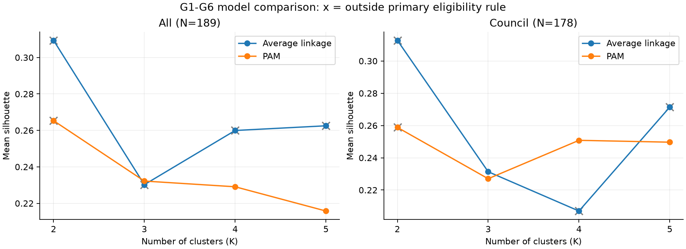
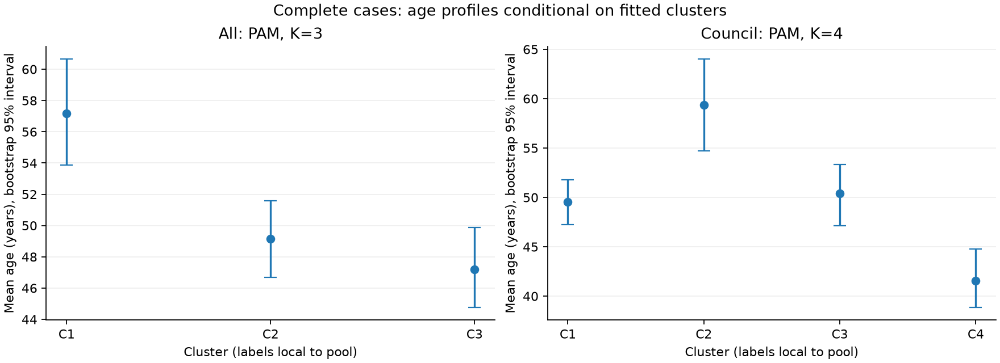
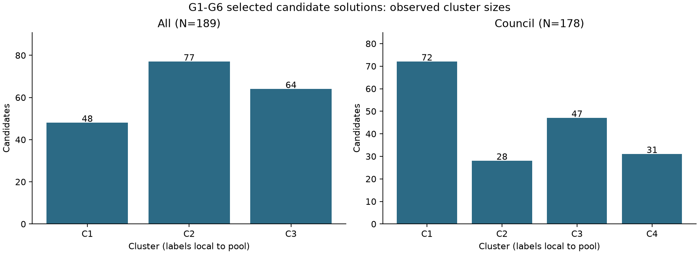

# 臺北、高雄G1–G6分群與方法比較（2026-11-11）

張睿庠／RUEI-HSIANG, CHANG（B12303030；AI協助）。

依使用者本輪更正，六個G欄共同參與分群；使用者明確選完整觀察，210人排除21位缺年齡議員，保留189（臺北91、高雄98；首長11、議員178）。排除者全是首次參選，使首次比例23.8%降為15.3%，研究樣本不代表所有210人。游智彬研究暫納入限制保留。

[已執行分析Notebook](../finding/taipei_kaohsiung_g1_g6_model_comparison_20261111.ipynb)、[189人資料準備](../data/code/prepare_tk_g1_g6_complete_20261111.ipynb)、[九檔資料文件](../data/processed/tk_g1_g6_20261111_documentation.ipynb)。

## 六個欄位如何進入模型

| 欄位 | 距離處理 |
| --- | --- |
| G1 年齡 | 年齡差除以完整樣本全距59歲 |
| G2 來源性別 | 相同0、不同1 |
| G3 公開學歷三類 | 主要相同0、不同1；有序編碼另作敏感度 |
| G4 登記政黨五類 | 相同0、不同1；未推薦不等於已查證無黨籍 |
| G5 首次參選 | 對稱二元，0曾參選、1首次 |
| G6 公職親屬搜尋 | 對稱二元，0搜尋未發現、1有來源支持；0非證明無親屬 |

Gower距離取六欄差異的等權平均，三池固定相同年齡尺度。PAM以實際候選人為代表點、最小化到代表點的距離；階層式採average linkage。比較K2–5；主要依提案K3–5及每群至少8人，選可行解中silhouette最高者。所有S策略、城市、公職種類及舊P碼均不參與距離。方法來源：[Gower](https://stat.ethz.ch/R-manual/R-devel/library/cluster/html/daisy.html)、[PAM](https://stat.ethz.ch/R-manual/R-devel/library/cluster/html/pam.html)、[average linkage](https://docs.scipy.org/doc/scipy/reference/generated/scipy.cluster.hierarchy.linkage.html)。

## 候選解與限制

| 池 | 候選方法 | K | 群人數 | Silhouette |
| --- | --- | ---: | --- | ---: |
| 合併189人 | PAM | 3 | 48／77／64 | 0.2322 |
| 議員178人 | PAM | 4 | 72／28／47／31 | 0.2508 |
| 首長11人 | 僅探索，未選正式主解 | — | 不可能多群每群至少8人 | — |

合併階層式K3–5均有3人小群；議員階層式K3符合人數（141／9／28），但silhouette為0.2313，低於PAM K4。**這只是限定K3–5及群大小下的候選解。** K2的silhouette較高：合併PAM0.2653、階層式0.3094（181／8）；議員PAM0.2588、階層式0.3128（169／9），完整列在[模型診斷](../data/processed/tk_g1_g6_model_diagnostics_20261111.csv)，不隱藏替代群數。

200次bootstrap：合併PAM三群Jaccard約0.636／0.727／0.805；議員PAM四群約0.645／0.498／0.604／0.369。議員群組有明顯不穩定。30次列序重排合併PAM平均ARI0.993，議員PAM均1；兩種穩定性不能混為一談。分位數是重抽分布，不是群成立機率。

學歷改有序編碼後，共同候選人ARI合併0.801、議員0.428；排除5筆未公開學歷政策碼後合併1.000、議員0.333。**議員4群應維持探索性，不適合直接固定為後續策略比較的唯一類型。** 合併解也僅有有限分離度，不把silhouette稱為完美。

## 合併池三群如何描述

| 群 | N | 平均年齡 | 女性 | 研究所 | 登記政黨最多類 | 首次參選 | G6正值 |
| --- | ---: | ---: | ---: | ---: | --- | ---: | ---: |
| C1 | 48 | 57.2 | 12／48 | 7／48 | 未推薦25／48 | 7／48 | 4／48 |
| C2 | 77 | 49.2 | 16／77 | 65／77 | 民進黨48／77 | 15／77 | 9／77 |
| C3 | 64 | 47.2 | 49／64 | 47／64 | 國民黨45／64 | 7／64 | 48／64 |

這些是參與分群的背景描述，非獨立驗證、策略差異或因果結論。C碼只在同池同解有意義，不對應舊P00等組合，也不能跨池當同一類。

年齡區間以固定已擬合群內2000次bootstrap計算，未涵蓋分群選擇不確定性。各群人數圖為樣本計數：

## 產出與銜接

[189人輸入](../data/processed/tk_g1_g6_complete_20261111.csv)、[21人排除](../data/processed/tk_g1_g6_exclusions_20261111.csv)、[所有方法／K逐人結果](../data/processed/tk_g1_g6_all_solutions_20261111.csv)、[候選主解逐人結果](../data/processed/tk_g1_g6_selected_assignments_20261111.csv)、[群特徵](../data/processed/tk_g1_g6_profiles_20261111.csv)、[bootstrap](../data/processed/tk_g1_g6_bootstrap_20261111.csv)、[列序敏感度](../data/processed/tk_g1_g6_order_sensitivity_20261111.csv)、[編碼敏感度](../data/processed/tk_g1_g6_coding_sensitivity_20261111.csv)。合併與議員候選主解逐人表共367列，代表189+178個池內觀察，不是367位不同候選人。

三份Notebook已clean kernel執行，九份CSV逐檔回讀schema／值／鍵與hash通過；PAM小樣本窮舉目標及單交換核對、Gower公式交叉檢查通過。全部六欄實際入距離，沒有使用S欄挑群。原210人來源hash不變。

原G5/G6分群Notebook與報告已依使用者要求移除；底層來源資料保留。11/10舊簡報未更新，不代表本輪六欄模型。S1工作單仍是210人與原P碼快照，未任意替21名年齡缺值者產生新群別。本輪檔案本地待學生檢閱、stage、commit與push；AI未執行Git寫入。
