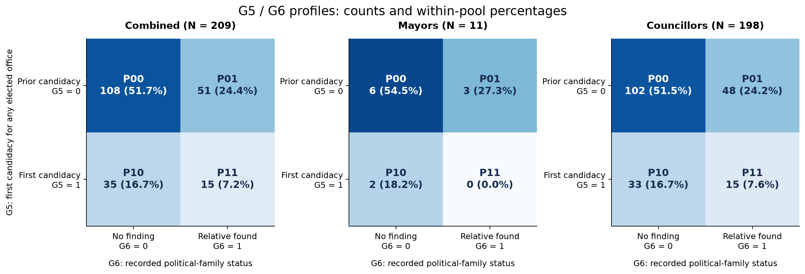
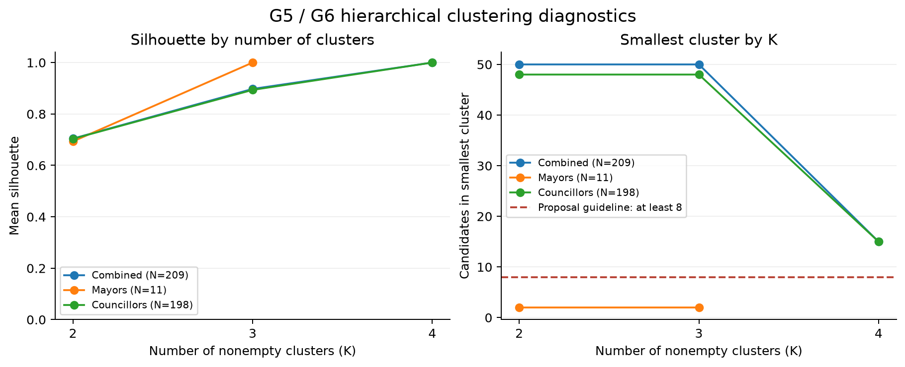

# 臺北、高雄：G5／G6分群結果（2026-11-08）

> **後續版本**：學生其後決定研究暫納入游智彬；[210人暫納入版](taipei_kaohsiung_g5_g6_yu_provisional_20261108.md)已重跑。以下209人結果保留作排除版敏感度對照。

作者：RUEI-HSIANG, CHANG／張睿庠（B12303030；AI協助）。

已完成兩市合併、兩市首長、兩市議員三池分群，只有G5「首次參選任何民選公職」與G6「公職親屬搜尋編碼」參與距離。
本次依學生新指令開始兩欄分群，取代先前等全部G1–G6補齊的條件；沒有按縣市各跑一套。

三池G5、G6均無缺值，因此實際缺值排除**0人**：合併209、首長11、議員198。
21位缺年齡者全保留，因年齡不是本次特徵。上游已因資格不符排除的游智彬不再算本次缺值刪除。

## 主結果

| 固定群碼 | 背景組合 | 合併 N=209 | 首長 N=11 | 議員 N=198 |
| --- | --- | ---: | ---: | ---: |
| P00 | 曾參選／搜尋未發現公職親屬 | 108 | 6 | 102 |
| P01 | 曾參選／有公職親屬 | 51 | 3 | 48 |
| P10 | 首次參選／搜尋未發現公職親屬 | 35 | 2 | 33 |
| P11 | 首次參選／有公職親屬 | 15 | 0 | 15 |

P後第一碼為G5，第二碼為G6：G5=1首次、0曾參選；G6=1有符合定義公職親屬、0完成紀錄搜尋未發現。
G6=0不是證明沒有親屬，一般軍職與常任文官依學生指示不計；原證據層級與推論註記隨逐人結果保留。
合併及議員各4個非空群，首長3群；首長P11未出現，0人格不算一群。

## 方法與解讀

沿用[提案](DSSI2026-group-3.md)的對稱Gower類別距離與average linkage。兩欄等權重，距離等於不同欄位數除以2，只可能0、0.5或1。
將階層樹切在距離0，主群即相同G5／G6組合；最多4種。本次沒有用年齡、性別、學歷、黨派或縣市計算距離。
平均連結為所有跨群成對距離的平均；實作及並列距離限制見[SciPy官方文件](https://docs.scipy.org/doc/scipy/reference/generated/scipy.cluster.hierarchy.linkage.html)。

另比較K=2–4（首長2–3）、100次列順序重排及500次bootstrap；seed=20261108。
合併K=2／3平均silhouette為0.7042／0.8975；議員0.7033／0.8936；首長K=2為0.6932。
主群silhouette均1，原因是同群相同兩欄組合的重複值、群內距離0；**不能因此宣稱找到完美或豐富的潛在政治類型**。

較少K會合併不同組合，且受0.5距離並列影響。100次重排中，合併K=2／3僅61%／56%與固定鍵排序基準相同；議員59%／51%；首長K=2為38%。
三池主群100次皆一致，因此以完整觀察組合呈現，不替其中某個並列的較少K解賦予唯一類型意義。
這些百分比是實作敏感度診斷，不是顯著性或類型成立的機率。

合併及議員主群最小15人，符合提案每群約8–10人的人數指引；首長最小僅2人。
首長全池11人，任意K≥2不可能每群至少8人，**首長結果僅作描述，不用小群直接推論策略差異**。
500次bootstrap中，首長P10（2人）整群未抽到43次（8.6%），P01（3人）17次（3.4%）；合併及議員主群均在每次出現。
完整原群Jaccard受未抽中成員比例影響，約0.63；抽到成員條件下的Jaccard=1是同組合分類的必然結果，非來源可靠度或外部效度認證。

## 結果檔與驗證

- [完整已執行分析Notebook](../finding/taipei_kaohsiung_g5_g6_clustering_20261108.ipynb)：clean kernel、實際表圖、精確輸入SHA、方法、診斷與CSV回讀檢查。
- [合併池逐人群別](../data/processed/tk_g5_g6_all_assignments_20261108.csv)、[首長池逐人群別](../data/processed/tk_g5_g6_mayor_assignments_20261108.csv)、[議員池逐人群別](../data/processed/tk_g5_g6_council_assignments_20261108.csv)。
- [組合人數](../data/processed/tk_g5_g6_profiles_20261108.csv)、[K診斷](../data/processed/tk_g5_g6_k_diagnostics_20261108.csv)、[替代K逐人結果](../data/processed/tk_g5_g6_alternative_assignments_20261108.csv)。替代C碼只能在同池同K內解釋；跨池固定P碼可比。
- [缺值排除表（0列）](../data/processed/tk_g5_g6_exclusions_20261108.csv)、[列順序敏感度](../data/processed/tk_g5_g6_order_sensitivity_20261108.csv)、[bootstrap](../data/processed/tk_g5_g6_bootstrap_20261108.csv)。
- [輸出文件](../data/processed/tk_g5_g6_20261108_documentation.ipynb)、[逐檔manifest](../data/processed/tk_g5_g6_output_manifest_20261108.json)、[驗證紀錄](../data/processed/tk_g5_g6_validation_20261108.json)。

9份CSV均已逐檔回讀比對schema與序列化值；候選人鍵唯一、209=11+198、來源欄位及跨池P碼一致。3份原輸入SHA未變。
原資料仍是截至11/8取得的資格審定版；正式公告後需再核名單。G6搜尋負值可能反映公開資訊程度差異，保留既有編碼限制。
本次未蒐集或分析策略指標，無策略差異或因果結論。全部成果保存本地；尚未stage、commit或push，依課程由學生自行提交。

建議學生提交訊息：`Cluster Taipei and Kaohsiung candidates using G5 and G6`。
