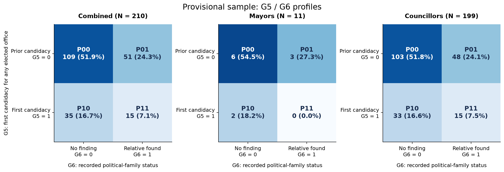
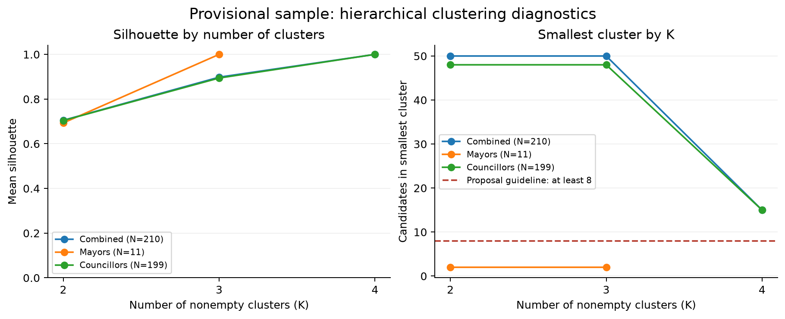

# 臺北、高雄G5／G6分群：游智彬暫納入版（2026-11-08）

作者：RUEI-HSIANG, CHANG／張睿庠（B12303030；AI協助）。

依學生本次明確決定，將游智彬先視為研究可納入的候選人，加入兩市合併池及議員池。新版合併**210人**、首長**11人**、議員**199人**。
只使用G5／G6，這兩欄缺值排除0人。原209人版及其分群結果保留，作為排除游智彬的對照。

## 報告中的資格不確定性註記

> 游智彬之參選資格存在爭議，本研究依2026年11月8日的研究決定先暫納入，標示「資格爭議／待後續確認；研究暫納入」。後續若有正式候選人名單、資格處分或司法程序更新，再確認是否繼續納入。

這是研究樣本的暫時處理；官方紀錄仍另列10月16日審定資格不符，以及11月6日暫時救濟抗告遭駁回。
最高行政法院新聞稿記載他有申請登記，但本次裁定未准其暫時取得參選資格，本案法律爭議仍待訴訟釐清。[官方新聞稿](https://www.judicial.gov.tw/tw/cp-1888-1645308-4e8cf-1.html)

因此，資料中的研究旗標為`eligibility_provisional_flag_20261108=1`，官方資格狀態保留`not_approved…`；沒有把「研究暫納入」覆寫成「官方已合格」。
使用者原指令與標準化決定保存在[原始決定](../data/raw/you_zhibin_provisional_20261108/user_inclusion_decision.json)。研究註記不將官方程序誤述成尚未審查完畢。

## 游智彬的分群欄位

G5沿用上游核對後的0（非首次參選任何民選公職）。G6原本未搜尋，這輪補做記錄搜尋後編0，意義為「未發現配偶或三親等內符合範圍的公職親屬」。

查到的外叔公游日正曾任鄉長／立委，關係採三立報導之鏡週刊轉載，屬次級證據。[關係報導](https://www.mirrormedia.mg/external/setn_1627531)
依[民法968條親等計算](https://law.moj.gov.tw/LawClass/LawSingle.aspx?pcode=B0000001&flno=968)，候選人→母親→外祖父→同源上一代→外叔公為四親等，超出已確認的三親等範圍。
外公另有軍人轉業公務員、鹽場辦公室副主任職涯記載，依學生先前排除一般軍職／常任文官的規則不計入；未取得可採的政治任命公職證據。[職涯報導](https://www.observer-taipei.com/book2021/item/3118-2023-12-01-05-51-37)

G6=0是現行範圍與搜尋結果，不能寫成「沒有任何政治人物親戚」。10個實際查詢、全文來源與排除線索見[G6查核紀錄](../data/raw/you_zhibin_provisional_20261108/G6_search_and_coding.json)。
游智彬因此分至P00「曾參選／搜尋未發現符合範圍公職親屬」。資格旗標不參與距離。

## 暫納入後的主群

| 固定群碼 | 背景組合 | 合併 N=210 | 首長 N=11 | 議員 N=199 |
| --- | --- | ---: | ---: | ---: |
| P00 | 曾參選／搜尋未發現公職親屬 | 109 | 6 | 103 |
| P01 | 曾參選／有公職親屬 | 51 | 3 | 48 |
| P10 | 首次參選／搜尋未發現公職親屬 | 35 | 2 | 33 |
| P11 | 首次參選／有公職親屬 | 15 | 0 | 15 |

沿用原版等權重對稱Gower類別距離（兩欄即Hamming距離）、average linkage與距離0切樹；主群數4／3／4。
只有兩個二元欄位，主群即觀察到的組合。主群silhouette=1由同組合重複造成，不是豐富潛在類型的外部驗證。

## 納入／排除的敏感度比較

學生原先認為影響可能有限，本輪以相同方法、相同seed與固定鍵排序實際比較，沒有先把這個想法寫成結論。

| 樣本池 | 人數變動 | 原有候選人主群變動數 | 共同候選人ARI | 最大群比例差（百分點） |
| --- | ---: | ---: | ---: | ---: |
| all | 209 → 210 | 0 | 1 | 0.2301 |
| mayor | 11 → 11 | 0 | 1 | 0.0000 |
| council | 198 → 199 | 0 | 1 | 0.2436 |

原209位候選人的主群碼全不變；合併池只增加P00一人（108→109），議員池P00亦增加一人（102→103），首長池不變。
各群比例最大變動約0.24百分點，因此可在報告中寫「納入游智彬對本次G5／G6分群的變動有限」。
固定鍵排序下，K=2與K=3的共同候選人分割ARI也均為1；較少K仍有原先的距離並列問題，不能因此說列順序敏感度已消失。
本輪亦重跑100次列順序重排與500次bootstrap；主群在100次重排均一致，首長小群仍僅2–6人，僅作描述。

**本輪沒有投票、得票、勝負或席次資料，不能將分群穩定延伸成「不影響實際選舉結果」。**
若後續確定改採排除，原209人版已完整保存，可直接作對照並重新確認正式樣本。

## 交付與實際驗證

- [已執行分群Notebook](../finding/taipei_kaohsiung_g5_g6_yu_provisional_20261108.ipynb)：實際圖表、K診斷、100次順序／500次bootstrap、逐人納入前後比較。
- [研究暫納入處理](../data/code/include_you_zhibin_provisional_20261108.ipynb)、[原始來源文件](../data/raw/you_zhibin_provisional_20261108_documentation.ipynb)、[準備與結果文件](../data/processed/taipei_kaohsiung_yu_provisional_20261108_documentation.ipynb)：均clean kernel執行，保留輸出。
- [210人逐人群別](../data/processed/tk_g5_g6_yu_provisional_all_assignments_20261108.csv)、[首長群別](../data/processed/tk_g5_g6_yu_provisional_mayor_assignments_20261108.csv)、[議員群別](../data/processed/tk_g5_g6_yu_provisional_council_assignments_20261108.csv)。
- [納入敏感度](../data/processed/tk_g5_g6_yu_provisional_inclusion_sensitivity_20261108.csv)、[各組合比例差](../data/processed/tk_g5_g6_yu_provisional_profile_sensitivity_20261108.csv)、[資格／研究納入稽核](../data/processed/taipei_kaohsiung_yu_provisional_eligibility_audit_20261108.csv)。
- [原209人排除版](taipei_kaohsiung_g5_g6_clustering_20261108.md)保留歷史數值，與本新版分開。

15份CSV逐檔回讀schema與序列化值；來源SHA、原209人全部既有欄位不變、210=11+199、唯一鍵、資格旗標與P碼、比例差均通過。
三個新版分析輸入精確路徑為`data/processed/taipei_kaohsiung_yu_provisional_{all,mayor,council}_20261108.csv`。
本次僅保存本地檔案，未stage、commit或push；GitHub比較分支仍只有先前基準commit。
